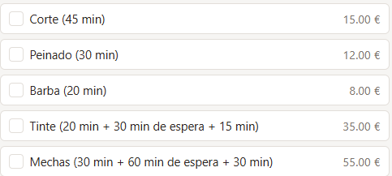
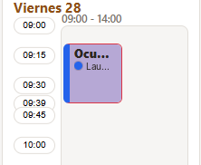
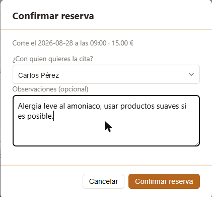

# Castor Barber Shop – appointment booking

A full-stack booking app for a hair salon with several workers. Customers create an account, pick one or more services, see each worker's free slots in a weekly calendar and book. The salon manages services, workers, schedules, days off, payments and users from its own admin panel.

**Stack:** Java 21 · Spring Boot 3 · PostgreSQL · React 18 · TypeScript · Docker · Render

Castor Barber Shop is a made-up brand. I built this as a demo for a friend who is starting out as a hairdresser, in case he wants to use it for his appointments in the future. The UI is in Spanish.

<p>
  
</p>

| Choose services | Choose a time | Confirm |
|---|---|---|
|  |  |  |

## Features

- **Multi-service booking.** A customer can combine several services in one appointment (for example, haircut + styling).
- **Services with waiting time.** Each service is a sequence of *work* and *wait* steps. Highlights, for example, are 30 min work + 60 min wait + 30 min work. During a wait step the worker is free to take another customer, and the availability engine takes that into account.
- **Several workers.** Each one has their own weekly schedule, a colour in the calendar and the services they can do. The customer chooses who they want among the workers who are free and qualified at that time.
- **Roles.** `USER` (customer), `ADMIN` (worker or manager) and `SUPERADMIN` (everything, plus users, statistics and audit log).
- **Admin panel.** Appointment calendar, manual blocks (holidays, meetings), services, workers, users, and inviting new workers by email.
- **Payments and daily cash closing.** When an appointment is marked as done, the admin records the amount and payment method. At the end of the day they enter the cash counted, and the app compares it with what the appointments say.
- **Statistics.** Booked, done and cancelled appointments, broken down by worker and by service, for any date range.
- **Audit log.** Every relevant action (bookings, cancellations, changes to services, schedules or users) with user, date and IP. Logs are kept even if the account is deleted.
- **Accounts.** Email + password or Google Sign-In, email confirmation, password reset, terms and privacy pages (GDPR), and an in-app tutorial with screenshots.
- **Email alerts.** Optional email to the team when the server hits an unexpected error.
- **Custom branding.** Logo and favicon are plain files in `frontend/public/branding/`.

## Technical highlights

- **No double bookings.** Bookings take a pessimistic lock in the database, so two customers can't book the same slot at the same time. If it happens, the second one gets a clear message instead of a generic error.
- **Secure auth.** Passwords are hashed with BCrypt and sessions use JWT. Changing the password invalidates every token issued before (`credentials_changed_at`). Auth endpoints are rate-limited per IP: 10 login attempts every 5 minutes, and 10 sign-up or password-reset requests per hour.
- **Database migrations** with Flyway (`backend/src/main/resources/db/migration`). The project was first built on Oracle and later migrated to PostgreSQL.
- **Tests.** 12 backend test classes (controllers, JWT, rate limiter, availability rules and an integration test of the booking engine) and frontend tests with Vitest and Testing Library.
- **Deployment.** One `docker compose up` locally; `render.yaml` deploys database, backend and frontend on Render's free tier. The backend uses lazy initialisation to start faster on low-CPU hosting.

## Project structure

```
backend/             REST API in Spring Boot (Java 21)
frontend/            SPA in React + TypeScript (Vite)
scripts/             Maintenance scripts (reset test data)
docker-compose.yml   PostgreSQL + backend + frontend for local development
render.yaml          Deployment on Render (database + backend + frontend)
```

## Getting started

### 1. Requirements

- Docker Desktop.
- An SMTP account to send emails (sign-up, invitations, password reset). For example Brevo's free tier, or Gmail with an [app password](https://myaccount.google.com/apppasswords).

### 2. Environment variables

```bash
cp .env.example .env
```

Fill in at least:

| Variable | What it is |
|---|---|
| `DB_APP_USER`, `DB_APP_PASSWORD` | Local database user and password (the defaults are fine for development). |
| `MAIL_HOST`, `MAIL_PORT`, `MAIL_USERNAME`, `MAIL_PASSWORD`, `MAIL_FROM` | SMTP credentials. |
| `JWT_SECRET` | A long random string of your own (at least 32 characters). |
| `ADMIN_EMAIL` | The account created with this email becomes `ADMIN`. |
| `SUPERADMIN_EMAIL` | Same, for `SUPERADMIN`. Optional. |
| `GOOGLE_CLIENT_ID`, `VITE_GOOGLE_CLIENT_ID` | OAuth Client ID for "Sign in with Google". Optional: if empty, the button is hidden. |
| `ERROR_ALERT_EMAIL` | Where to send error alerts. Optional: if empty, no alerts are sent. |

### 3. Run everything

```bash
docker compose up --build
```

The backend waits for PostgreSQL to be healthy and applies the Flyway migrations automatically.

- Frontend: http://localhost:3000
- Backend API: http://localhost:8080/api

Create an account with the email you set in `ADMIN_EMAIL` or `SUPERADMIN_EMAIL` to see the admin panel.

A new database has no workers yet, so the booking page shows no free days. Either add a worker with a weekly schedule in **Panel admin → Trabajadores**, or load the [test data](#test-data).

### Without Docker (optional)

Backend (JDK 21 and Maven, plus a PostgreSQL instance, for example `docker compose up postgres-db`):

```bash
cd backend
export DB_URL=jdbc:postgresql://localhost:5432/peluqueria
export DB_USER=peluqueria
export DB_PASSWORD=CambiaEstaPassword1
export MAIL_HOST=... MAIL_PORT=... MAIL_USERNAME=... MAIL_PASSWORD=... MAIL_FROM=... JWT_SECRET=... ADMIN_EMAIL=...
mvn spring-boot:run
```

Frontend (served at http://localhost:5173, with `/api` proxied to the backend):

```bash
cd frontend
npm install
npm run dev
```

Tests: `mvn test` in `backend/` and `npm test` in `frontend/`.

## Test data

`scripts/reset-db.sql` leaves the database in a clean, realistic state: it deletes all appointments and every user except the superadmin, rebuilds the service catalogue, creates 10 fictional test users (2 workers + 8 customers, password `TempTest1234!`) and generates random appointments for 16 days that respect schedules and blocks. It is safe to run several times.

With the app running (works the same in PowerShell, cmd and bash):

```bash
docker cp scripts/reset-db.sql peluqueria-postgres-db-1:/tmp/reset-db.sql
docker exec peluqueria-postgres-db-1 psql -U peluqueria -d peluqueria -f /tmp/reset-db.sql
```

Then reload the page.

## Deploying on Render

`render.yaml` defines a managed PostgreSQL database and two web services (backend and frontend), each with its own `Dockerfile`. Variables marked `sync: false` must be filled in from the Render dashboard after the first deploy: SMTP credentials, admin emails, `CORS_ALLOWED_ORIGINS` and `FRONTEND_URL` with the real frontend URL, and `VITE_API_BASE_URL` with the real backend URL.

## How I built it

I built this with [Claude Code](https://claude.com/claude-code). My part was deciding what the app had to do for a real salon and testing it as a customer and as a worker:

- modelling services as work and wait steps, so a worker can take another customer while a colour sets;
- the rules for availability, cancellations, past appointments and payments;
- security decisions: rate limiting, token revocation on password change, audit log;
- moving the database from Oracle to PostgreSQL and deploying it on Render.

## Credits

Icons by Magnific and azmianshori on [Flaticon](https://www.flaticon.com) (see `frontend/public/branding/atribuciones.txt`).

## License

MIT
